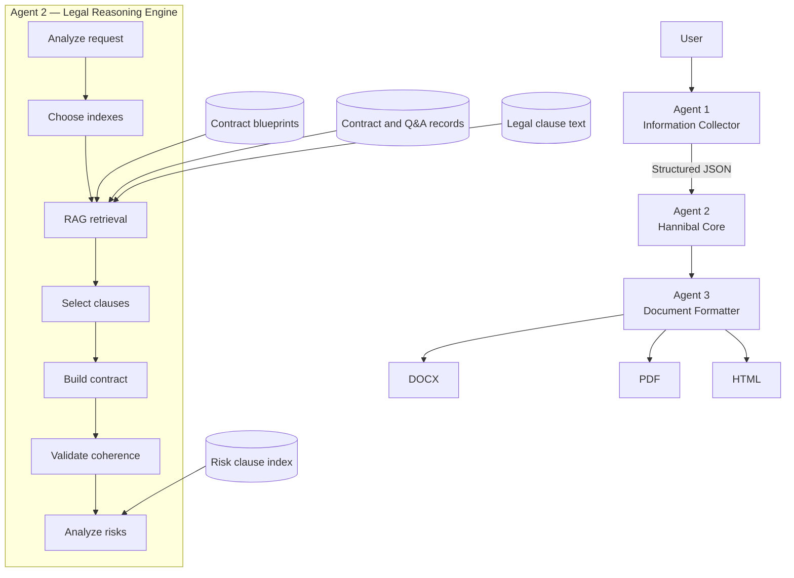

# Hannibal V2 Architecture

## 1. Architectural objective

Hannibal is E-Tafakna's engine for generating professional contracts adapted to multiple MENA jurisdictions. The required result combines:

- Coherent legal structure.
- Clauses adapted to user context.
- Conformity with the law of the relevant country.
- Drafting quality close to work produced by a lawyer.

It combines a multi-agent system, RAG, proprietary documentary databases, legal-reasoning models, validation, and document generation.

The governing architectural rule is:

> The model must never invent law. Law comes exclusively from the documentary databases.

The AI model may reason, organize, draft, reformulate, and explain retrieved material.

## 2. System context and runtime flow



The fine-tuned model and its specialized LoRA adapters belong inside Agent 2. They improve reasoning and drafting; the RAG indexes remain the source of legal content.

## 3. Agent boundaries

### 3.1 Agent 1 — Information Collector

Mission: collect all information required before generation.

Inputs listed by the specification:

- Contract type.
- Country.
- Language.
- Parties.
- Amounts.
- Duration.
- Specific information.

Output: structured JSON sent to Agent 2.

Prohibition: Agent 1 never drafts.

The Agent 1 → Agent 2 payload is fixed by `features/contract-template-dataset/agent_1_json_output.md` and must not be modified. Agent 2 may validate it and build a separate normalized model-facing view, but it must preserve the raw payload for traceability and must not invent or silently resolve missing or conflicting values.

`AMBIGUITY`: Authoritative Agent 2 precedence rules for duplicate or conflicting facts in the fixed Agent 1 payload are not yet defined.

### 3.2 Agent 2 — Hannibal Core

Agent 2 contains the project's legal reasoning intelligence. It must:

1. Analyze the request.
2. Choose the appropriate indexes.
3. Retrieve relevant documentary content through RAG.
4. Select clauses.
5. Construct the contract.
6. Verify coherence.
7. Analyze risks.

Its legal output must be grounded in retrieved records. Fine-tuning may improve the way Agent 2 selects, orders, and drafts content, but cannot supply missing law.

`AMBIGUITY`: The specification names a “Legal Planner” as the comparison source for missing-clause measurement, but does not place it in the three-agent architecture or define its interface.

`AMBIGUITY`: The interface between contract validation, risk analysis, and the payload passed to Agent 3 is not defined.

### 3.3 Agent 3 — Document Formatter

Mission: transform the generated contract into a professional document.

Responsibilities:

- Layout.
- Numbering.
- Table of contents.
- Signatures.
- Export.

Supported formats:

- DOCX.
- PDF.
- HTML.

Prohibition: Agent 3 contains no legal logic.

`AMBIGUITY`: The exact formatting input schema and whether risk-analysis results appear in the formatted document are not specified.

## 4. Documentary data architecture

`contrat_example.md` demonstrates four documentary record families.

### 4.1 Contract blueprint/template record

The employment example contains:

- Identity and classification: `id`, `type`, `template_type`, `contract_category`, `default_language`, and `version`.
- Coverage: `supported_jurisdictions` and `compatible_structures`.
- Retrieval preferences: `search_priority`, `structure_priority`, `similarity_threshold` of `0.65`, and `max_similar_results` of `3`.
- Section policy: `mandatory_sections`, `conditional_sections`, and `total_sections`.
- Behavior flags for jurisdiction detection, fallbacks, language preference, style adaptation, legal references, validation, audit trail, and source tracking.
- Per-section blueprint fields: section name, purpose, template structure, variable points, required elements, and adaptation hints.
- `vector`.

The example defines ten populated sections:

1. Parties.
2. Recitals.
3. Definitions.
4. Employment terms.
5. Term and renewal.
6. Employee obligations.
7. Termination.
8. Financial responsibilities.
9. Governing law and reference.
10. Signatures.

Eight are mandatory: parties, employment terms, term and renewal, employee obligations, termination, financial responsibilities, governing law and reference, and signatures. Recitals and definitions are conditional.

`RESOLVED (2026-08-11)`: Production contract-template records normalize populated sections and clauses into ordered lists. The flattened fields through section 50 remain only in the preserved source example.

`AMBIGUITY`: The same blueprint identifier appears twice and is followed by an empty object. The source does not state whether this duplication is intentional.

`AMBIGUITY`: The example marks definitions as conditional while also setting `auto_add_legal_definitions` to true. It also enables `auto_add_dispute_resolution` without defining a separate dispute-resolution blueprint section. The insertion rules and effect on `total_sections` are not specified.

### 4.2 Contract context and question/answer record

The `cuad index : contract` examples contain:

- `id`.
- `country_code`.
- `title`.
- Full `context` contract text.
- Fifteen repeated question groups made of `question_n`, `answers_text_n`, `answer_start_n`, and `has_answer_n`.
- `vector`.

The two examples are Tunisian:

- A personal-service contract.
- A simple exchange without a balancing payment.

`AMBIGUITY`: The example is presented as fragments rather than a complete ingestible JSON collection, and the displayed vectors are truncated.

### 4.3 Risk-clause record

The risk examples contain:

- `id`, `jurisdiction`, `contract_type`, and `clause_type`.
- `risk_name`, `risk_category`, `description`, and `detection_patterns`.
- `risk_level` and `probability`.
- `legal_basis`, `recommendation`, and `impact`.
- `keywords`, `embedding_text`, and `vector`.

The supplied examples cover Tunisian transport-person bodily injury exclusions and drawer payment-guarantee exclusions in bills of exchange.

### 4.4 Legal-clause text record

The `accord: clauses` examples contain:

- `id`.
- Legal clause `text`.
- `vector`.

The supplied fragments include an apprenticeship clause and a clause concerning a suspensive condition.

`AMBIGUITY`: The exact production index names vary between `cuad index : contract`, `cuad-unified`, and the roadmap's reference to `accords_index`; canonical index names are not specified.

`AMBIGUITY`: Embedding model, vector dimension, vector normalization, distance metric, and indexing engine are not specified.

## 5. Fine-tuning architecture

### 5.1 Boundary

Fine-tuning targets:

- Drafting quality.
- Contract structure.
- Clause selection.
- Global coherence.
- Legal style.
- Reasoning ability.
- MENA style adaptation.
- Reduction of format errors and clause omissions.

Fine-tuning does not learn or replace laws. Laws stay in RAG.

### 5.2 Base-model candidates

Recommended candidates:

- Llama 3.1 8B.
- Mistral 7B.

Reason given by the source: open-source, performant, multilingual in French, English, and Arabic, and suited to legal work.

Alternative:

- GPT-4o-mini through Azure fine-tuning.

`AMBIGUITY`: No final base model is selected.

### 5.3 Adaptation method

- Full fine-tuning: discouraged because of GPU and time cost.
- LoRA: recommended; described as faster and using 75–95% less memory, with a slight performance loss.
- QLoRA: acceptable alternative; described as using four times less memory and being somewhat slower than LoRA.

`AMBIGUITY`: The recommended hyperparameter table includes 4-bit quantization marked for QLoRA while LoRA is the preferred method. Whether quantization is enabled in the default training profile is not stated.

### 5.4 Specialized adapters

The source specifies one base model with multiple specialized LoRA adapters:

| Adapter | Contract types | Source priority |
|---|---|---|
| Hannibal-Employment | CDI, CDD, freelance, employment contract | Priority 1 |
| Hannibal-Commercial | Services, NDA, MSA, partnership | Priority 2 |
| Hannibal-SaaS | SaaS contracts, API access, cloud services | Priority 3 |
| Hannibal-NDA | Confidentiality, NDA | Priority 4 |
| Hannibal-Investment | Investment, shareholders, pact | Phase 2 |
| Hannibal-RealEstate | Leases, purchase, sale | Phase 2 |
| Hannibal-Procurement | Purchases, suppliers | Phase 2 |

Agent 2 must be capable of loading adapters dynamically.

`AMBIGUITY`: NDA appears under both Hannibal-Commercial and Hannibal-NDA, but no routing precedence is defined.

## 6. Training data flow

The standard training record is Alpaca JSON:

```json
{
  "instruction": "Génère un contrat de travail CDI pour un développeur senior en Tunisie, salaire 3000 TND, période d'essai 3 mois.",
  "input": "Parties : E-Tafakna (employeur) et Norchen Mezni (employé). Date de début : 1er juillet 2026. Lieu : Tunis.",
  "output": "# CONTRAT DE TRAVAIL À DURÉE INDÉTERMINÉE\n\n## PARTIES\n...\n\n[CONTRAT COMPLET]"
}
```

The R&D plan defines four transformations:

```text
User intent -> contract blueprint
Contract blueprint -> clause list
Clause -> drafted legal text
Contract -> omissions and inconsistencies
```

The first three use generated-and-corrected, extracted-and-corrected, or indexed source material. Dataset D is stated to be generated by “Agent 4.”

The current `contract-template-dataset` feature implements only canonical contract-template construction and its 36-file pilot. Agent 2 intake normalization, Alpaca export, adapter training, and runtime knowledge-base integration are separate future work.

`AMBIGUITY`: No Agent 4 exists in the defined three-agent architecture.

## 7. Validation and observability

The architecture must support the measurements defined by the sources:

| Concern | Target | Measurement |
|---|---:|---|
| Mandatory sections | 100% in section 8; greater than 99% in section 13 | Compare with contract plan |
| Malformed placeholders | 0 | Automatic verification |
| Correctly replaced variables | Greater than 99% | Check `[À COMPLÉTER]` |
| Missing clauses | Less than 2% | Compare with Legal Planner |
| Internal contradictions | Less than 1% | Automated LLM validation |
| Legal hallucinations | 0% | Track reports |
| Drafting/legal style | Greater than 85% | GPT-4o evaluation |
| MENA adaptation | Greater than 80% | Local-lawyer evaluation |
| Contracts accepted without major change | Greater than 90% | Lawyer feedback |
| Review time | Less than 10 minutes per contract | Measured time |
| Generation time | Less than 15 seconds | Application logs |

`AMBIGUITY`: “100%” and “greater than 99%” are different mandatory-section targets.

`AMBIGUITY`: The prompts, scoring rubrics, test set, and repeatability rules for GPT-4o and LLM-based evaluation are not defined.

## 8. Infrastructure boundary

GPU options stated by the source:

| Option | GPU | VRAM | Estimated cost | Intended use |
|---|---|---:|---:|---|
| Minimal | NVIDIA A10G | 24 GB | ~€1/hour | Sufficient for QLoRA |
| Recommended | NVIDIA A100 | 40 GB | ~€3/hour | Rapid LoRA |
| Optimal | NVIDIA H100 | 80 GB | ~€6/hour | Longer training |

Cloud services listed by the source are Azure NCas-v4, RunPod, Vast.ai, and Google Colab Pro+.

Required software listed by the source:

```bash
pip install unsloth transformers datasets peft accelerate bitsandbytes
pip install wandb
```

`AMBIGUITY`: No GPU option or cloud provider is selected. The costs are source estimates, not a confirmed deployment budget.

## 9. Architectural ambiguity summary

- `AMBIGUITY`: Three-agent architecture versus the Dataset D reference to Agent 4.
- `AMBIGUITY`: Agent 2 precedence for conflicting Agent 1 facts and the Agent 2 → Agent 3 runtime contract are unspecified; the Agent 1 schema itself is fixed.
- `AMBIGUITY`: Legal Planner placement and interface are unspecified.
- `AMBIGUITY`: Canonical index names and detailed retrieval/ranking mechanics are unspecified.
- `AMBIGUITY`: Blueprint auto-added content does not map unambiguously to its conditional sections and ten-section count; the production representation as ordered section lists is resolved.
- `AMBIGUITY`: Base model, LoRA/QLoRA profile, GPU, and provider are not finally selected.
- `AMBIGUITY`: NDA adapter routing overlaps.
- `AMBIGUITY`: Mandatory-section KPI has two thresholds.
- `AMBIGUITY`: Evaluation rubrics and dataset splits are unspecified.

The complete cross-document register is maintained in `context.md`.
